<p align="center">
  
</p>

<h1 align="center">CryptoPilot AI</h1>

<p align="center">
  <b>One clear answer per coin: BUY, WAIT or SELL.</b><br />
  Real market data, checked on three independent sources, explained in plain English or Persian.
</p>

<p align="center">
  <a href="https://codespaces.new/sobhanizd/Trade?quickstart=1"></a>
</p>

<p align="center">
  <a href="https://sobhanizd.github.io/Trade/"><b>Website &amp; live price check</b></a> ·
  <a href="#try-it-live">Live dashboard</a> ·
  <a href="#quick-start">Quick start</a> ·
  <a href="#screenshots">Screenshots</a> ·
  <a href="#documentation">Docs</a>
</p>

<p align="center">
  
  
  
  
  
  
</p>

<p align="center">
  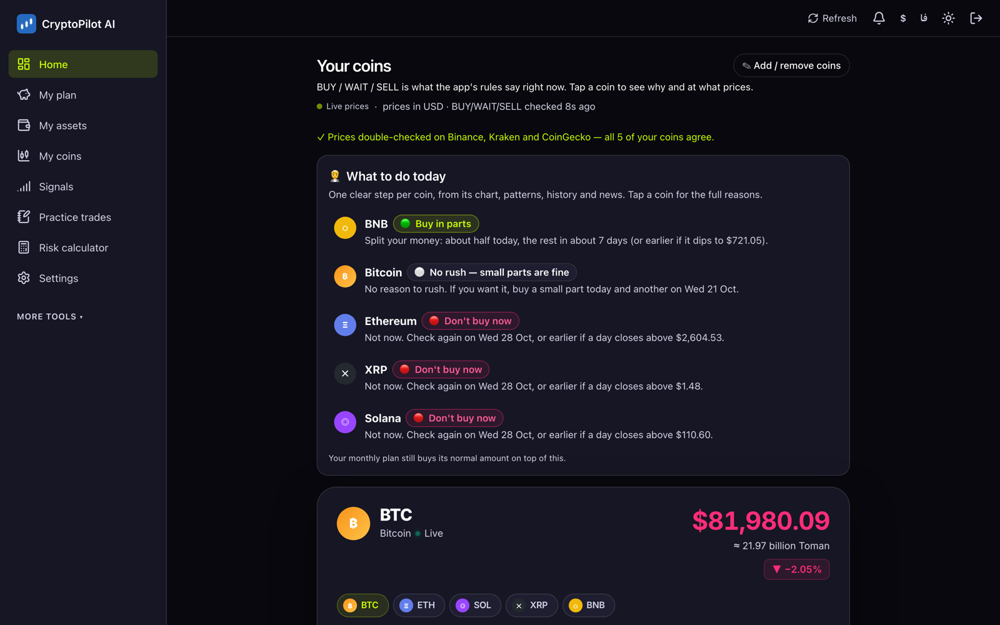
</p>

> **It never trades.** No wallet connection, no seed phrases or private keys, no exchange API
> keys, no order buttons. CryptoPilot explains; you decide and place every order yourself.
> Nothing here is financial advice and no result is guaranteed.

## What it is

CryptoPilot AI is a self-hosted web app for people who invest in crypto but are **not
professional traders**. It watches real market data, runs five transparent, written
strategies, and turns the result into one plain answer per coin, together with the reasons, the
price where the idea is wrong, and what happened in similar moments before.

- **One clear answer.** BUY / WAIT / SELL per coin, with a daily "what to do today" step:
  *buy in parts*, *no rush*, *don't buy now*.
- **Every number checked twice.** Live prices are compared across **Binance, Kraken and
  CoinGecko**; the chart data is cross-checked against a second exchange before every analysis;
  and every strategy gets a **second opinion** on the other exchange's data. If the sources
  disagree, the app gives *no signal* instead of a wrong one.
- **Charts that explain themselves.** Colored zones for "good buy zone", "too expensive",
  "safety exit" and "take profit", automatic trend lines, and a worked example in money.
- **Market picture.** Up, down or sideways for days, weeks and months, month-by-month changes,
  and what happened after similar moments since 2017 (history, not a forecast).
- **Monthly plan.** Invest a fixed amount every month: what to buy and when, progress toward
  your goal, and an honest test of the plan on past prices.
- **Backtests and practice trades.** Test strategies on years of real candles with fees and
  slippage, or practise with pretend money first.
- **English and Persian.** A full right-to-left Persian interface. Prices in dollars, euros or
  **Toman**: the rate starts at **1 € = 300,000 Toman** and you can change it any time
  (home page, currency menu or Settings).
- **Alerts.** Telegram, email or browser push for new signals, your own price levels and
  unusually large moves.
- **Private.** Runs on your own computer or a small server. Your coins, plans and settings never
  leave it.

## Screenshots

### Every number checked twice

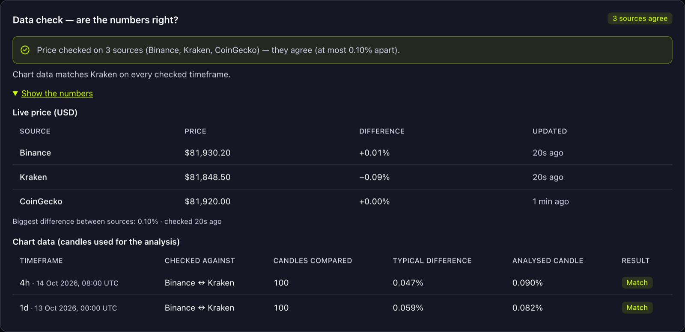

Each coin page shows whether the sources agree, with the numbers behind it: the live price on
three sources, and how closely the analysed candles match a second exchange.

### A coin, explained

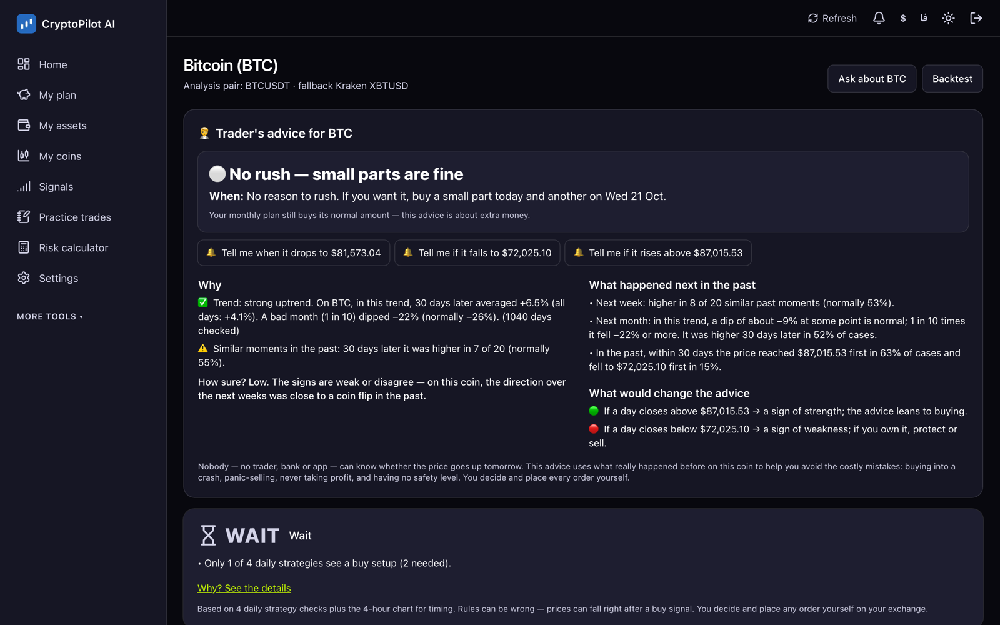

### Charts with buy, safety-exit and take-profit zones

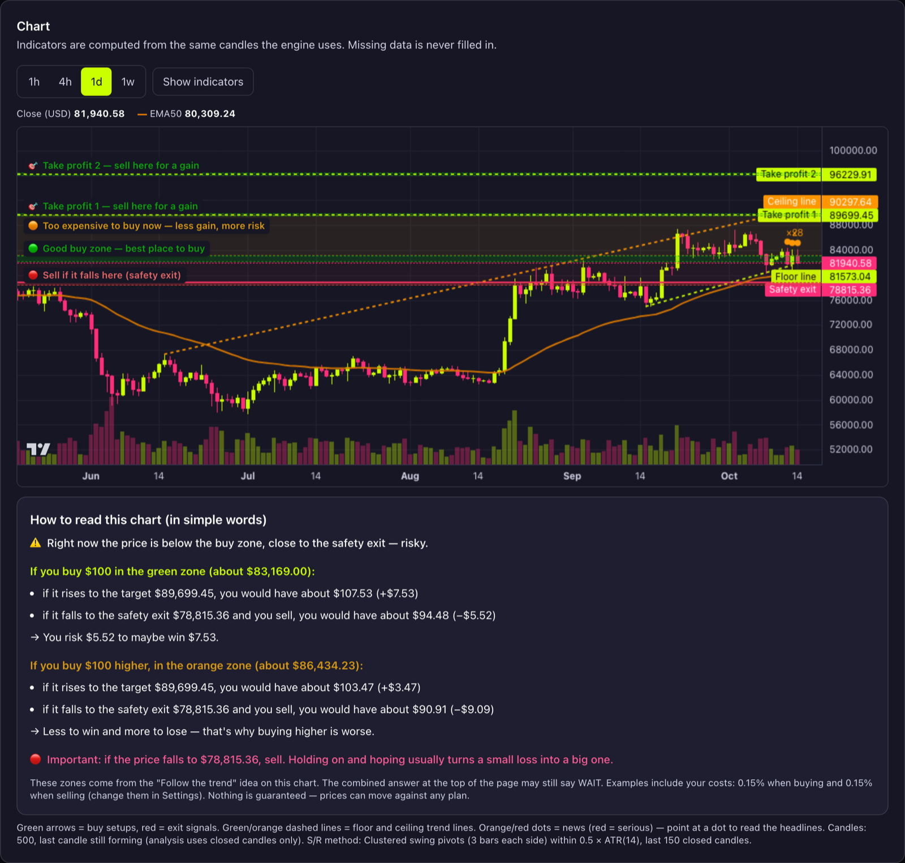

### Market picture

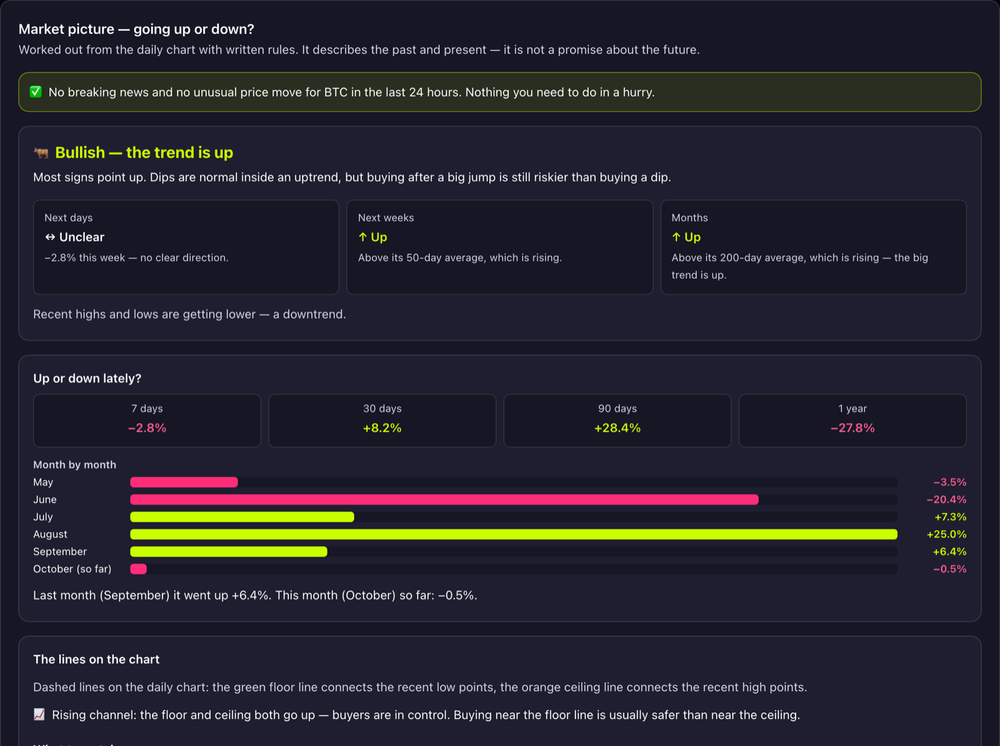

### Signals you can check

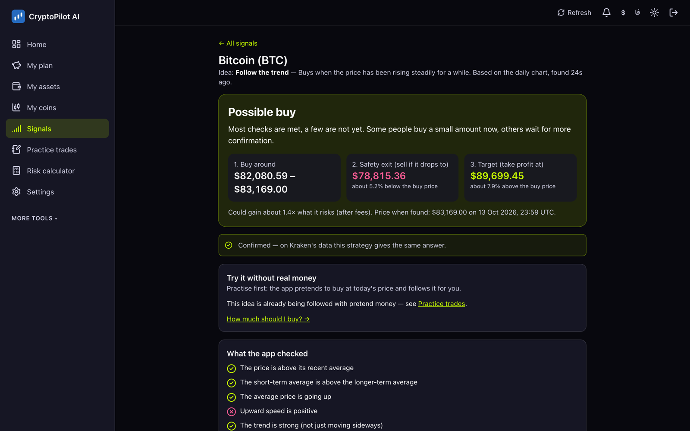

### Monthly plan and backtests

<table>
  <tr>
    <td width="50%">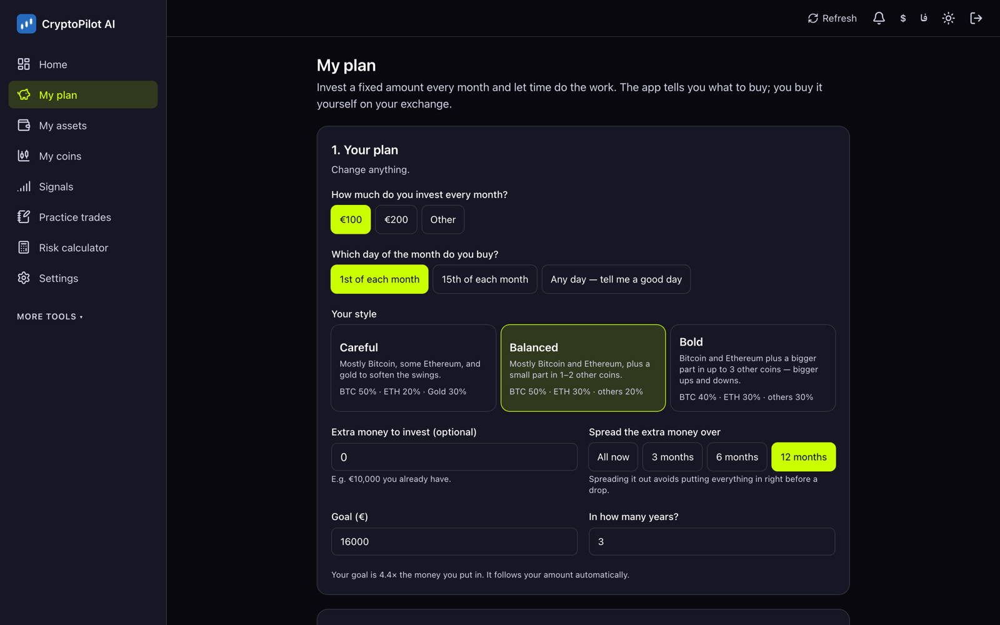</td>
    <td width="50%">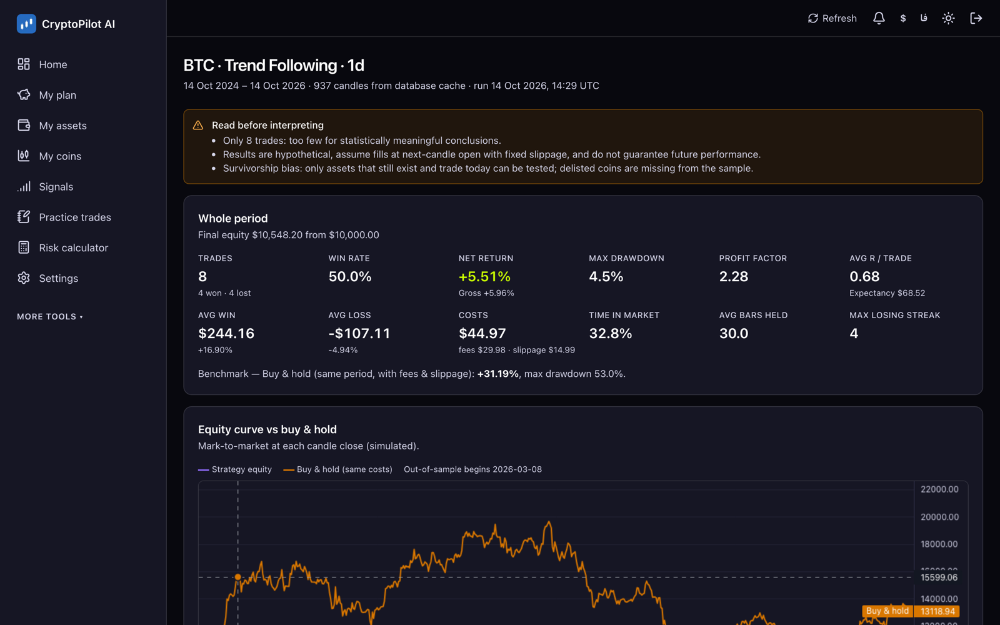</td>
  </tr>
</table>

### فارسی, right to left

<table>
  <tr>
    <td width="50%">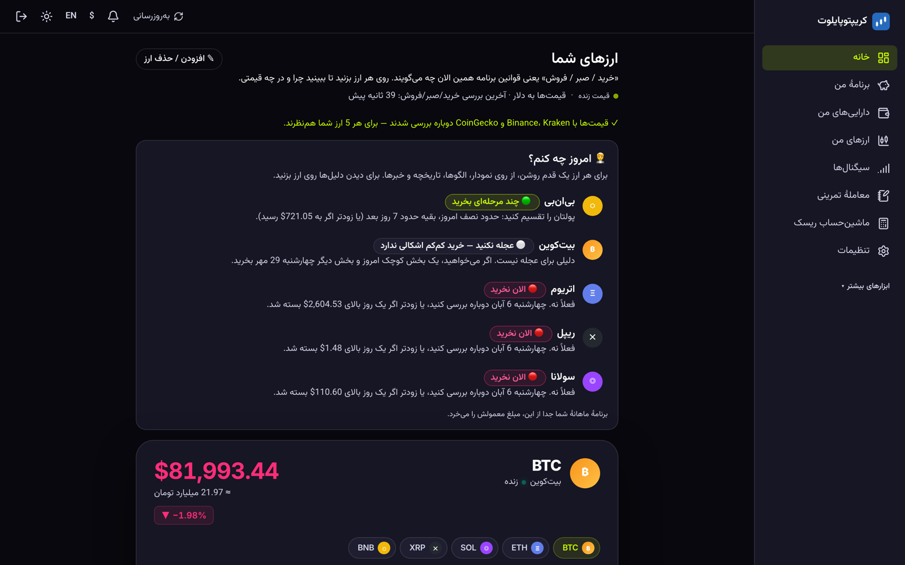</td>
    <td width="50%">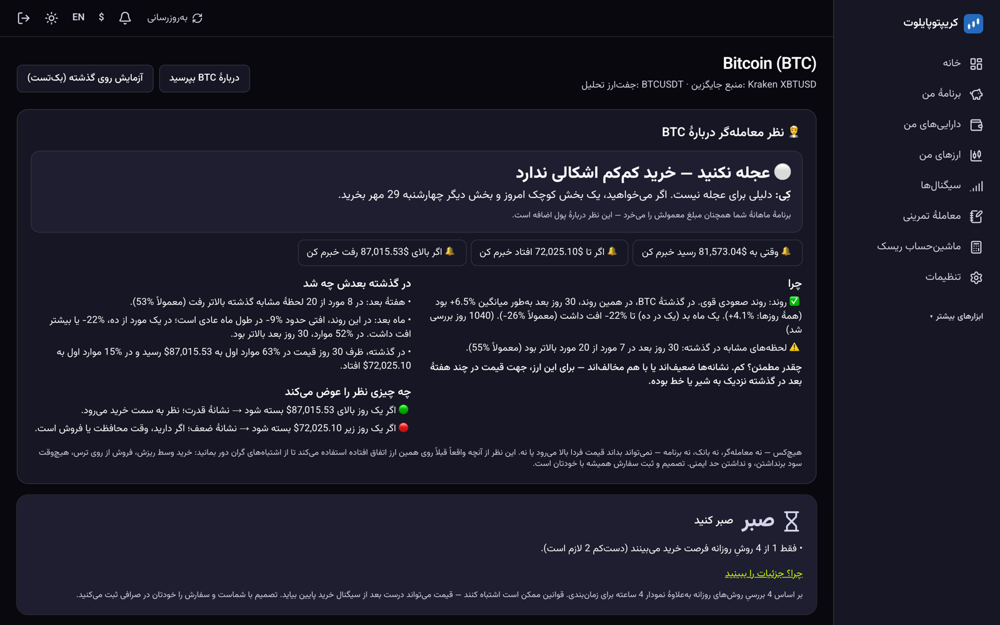</td>
  </tr>
</table>

### On your phone

<p>
  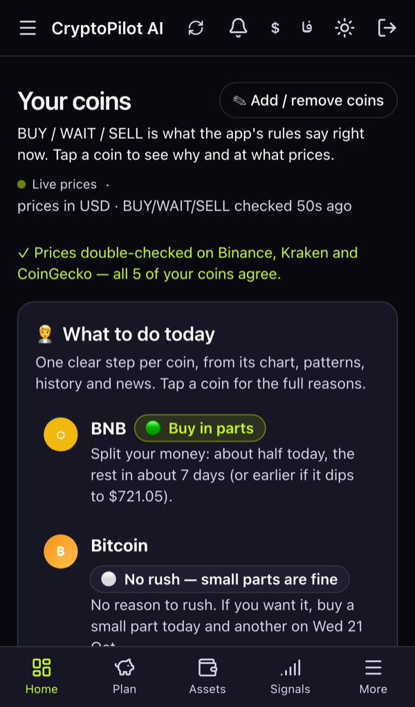
  &nbsp;&nbsp;
  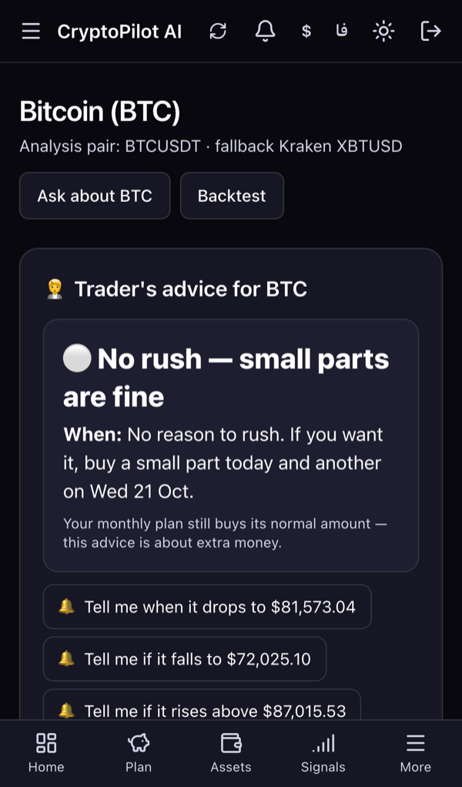
</p>

Installs like an app on iPhone (Safari → Share → *Add to Home Screen*) and Android.

*All screenshots are real, with real market data, taken from a demo account.*

## How it works

```
 Binance · Kraken · CoinGecko · alternative.me · ECB · news feeds
                         │
                         ▼
 ┌─────────────── Worker (every 5–10 min) ────────────────┐
 │ 1. collect   candles, prices, market mood, headlines   │
 │ 2. check     gaps, stale data, impossible values,      │
 │              three-source price & candle cross-check   │
 │ 3. analyse   5 written strategies on closed candles    │
 │              + second opinion on a second exchange     │
 │ 4. decide    BUY / WAIT / SELL, safety exit, target,   │
 │              history check                             │
 │ 5. tell you  home page, Telegram, email, push          │
 └────────────────────────┬───────────────────────────────┘
                          ▼
              PostgreSQL ◄──► Next.js web app (your browser)
```

- Live scans and backtests call the **same** evaluation function, so what you backtest is
  exactly what produces live signals.
- Indicators only use **closed** candles (no look-ahead, no repainting), and each candle is
  analysed once.
- An optional AI explainer can rephrase the stored analysis in plain language. It only reads
  results; it can never create, change or override a signal. Without an API key the app uses
  its built-in rule-by-rule explanations.

## Try it live

Click **[Open in GitHub Codespaces](https://codespaces.new/sobhanizd/Trade?quickstart=1)** to
start your own private copy of the whole app (database, background worker and dashboard) in the
cloud, free with a GitHub account. The first start takes about 5 minutes; a browser tab then
opens on the login page with the demo account filled in:

| Username | Password |
|---|---|
| `demo` | `cryptopilot-demo` |

It uses real market data; the first scan takes about a minute after start-up. Stop the
codespace when you are done (GitHub → Codespaces → ⋯ → Stop) so it doesn't use your free hours.

## Quick start

### With Docker (easiest)

```bash
git clone https://github.com/sobhanizd/Trade.git
cd Trade
cp .env.example .env
# edit .env: set SESSION_SECRET (64 hex chars) and POSTGRES_PASSWORD
docker compose up -d --build
docker compose run --rm worker npx tsx scripts/create-user.ts --username alex
```

Open <http://localhost:3000> and sign in. For a server with HTTPS (Caddy + Let's Encrypt),
see [docs/DEPLOYMENT.md](docs/DEPLOYMENT.md).

### With Node.js and PostgreSQL

Requires Node.js 20.19+ and PostgreSQL 14+.

```bash
git clone https://github.com/sobhanizd/Trade.git
cd Trade
npm install
cp .env.example .env            # set DATABASE_URL and SESSION_SECRET
npm run db:generate             # database client (needs DATABASE_URL)
npx prisma migrate deploy && npm run db:seed
npm run user:create -- --username alex      # asks for a password
npm run build && npm start      # web app on http://localhost:3000
npm run worker                  # in a second terminal: scans, prices and alerts
```

Full details: [docs/SETUP.md](docs/SETUP.md).

### Start and stop on a Mac

Double-click **`Start CryptoPilot.command`** to start the database, web app and background
scanner and open the login page; **`Stop CryptoPilot.command`** stops them. For one-click
buttons in a browser page (`index.html`), build the small launcher app once with
`zsh scripts/build-launcher.sh`.

## Project structure

```
prisma/            database schema, migrations, seed
src/app/           pages ((app)/… signed-in area), api/ routes, login
src/components/    UI, charts, app shell, data-check cards
src/lib/           all logic: market data & cross-checks, indicators, strategies,
                   signals, backtest, plan, risk, paper trading, alerts, i18n
worker/            background scheduler (scans, prices, news, maintenance)
scripts/           start/stop, create user, launcher build
tests/unit/        indicators, strategies, cross-checks, risk, backtest, quality…
tests/integration/ API routes, scan & snapshot jobs, notifications (real PostgreSQL)
e2e/               Playwright workflows (desktop + iPhone viewport)
deploy/            Caddyfile (HTTPS), backup script
docs/              documentation, screenshots and the project website
```

## Scripts

| Command | Purpose |
|---|---|
| `npm run dev` / `build` / `start` | Development server / production build / production server |
| `npm run worker` | Background scheduler (needed for signals, prices and alerts) |
| `npm run worker:once` | Run every job once and exit |
| `npm run user:create -- --username …` | Create an account or reset its password |
| `npm test` | Unit tests (181) |
| `npm run test:integration` | Integration tests against a separate `cryptopilot_test` database (34) |
| `npm run test:e2e` | End-to-end tests in a real browser (20; needs a build and internet) |
| `npm run lint` / `typecheck` | ESLint / TypeScript |
| `npm run vapid:generate` | Generate browser-push keys |

## Documentation

| Doc | What it covers |
|---|---|
| [SETUP](docs/SETUP.md) | Local installation, first user, running web + worker |
| [CONFIGURATION](docs/CONFIGURATION.md) | Every environment variable, data providers, AI explainer |
| [STRATEGIES](docs/STRATEGIES.md) | Indicators, the five strategies, signal states, **multi-source verification** |
| [BACKTESTING](docs/BACKTESTING.md) | Execution model, metrics, bias safeguards, limitations |
| [NOTIFICATIONS](docs/NOTIFICATIONS.md) | Telegram, email and browser-push setup |
| [DEPLOYMENT](docs/DEPLOYMENT.md) | Docker / VPS with HTTPS, installing on iPhone and Mac |
| [OPERATIONS](docs/OPERATIONS.md) | Backups, restore, updates, monitoring |
| [SECURITY](docs/SECURITY.md) | Threat model, auth, secrets, what is deliberately absent |
| [COSTS](docs/COSTS.md) | Monthly running costs and API budgets |
| [FEATURES](docs/FEATURES.md) | Everything implemented, and known limitations |
| [I18N](docs/I18N.md) | English/Persian translations, right-to-left rules |

## Disclaimer

CryptoPilot AI is a decision-support and learning tool. It does not give financial advice,
cannot know the future, and can be wrong; past results and backtests do not guarantee future
results. Crypto prices can fall a lot. Only invest money you can afford to lose.

## License

Copyright © 2026 Sobhan Izadi. All rights reserved.

The source code is public so you can read and review it. No license is granted to copy, modify
or redistribute it without written permission.
